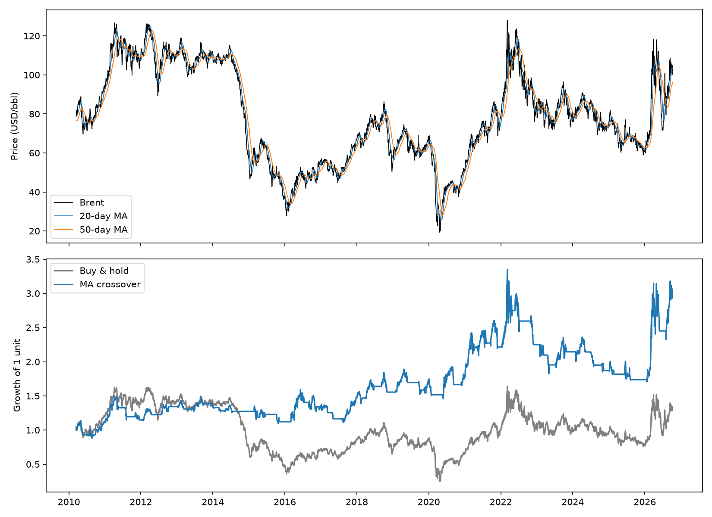

# Brent Crude Futures: Moving Average Backtest

A Python script that tests a simple trend-following rule on Brent crude oil
futures, using 16 years of daily prices, and compares it against just buying
and holding.

The rule is a **20/50-day moving average crossover**. The script reports total
return, yearly return, **max drawdown**, number of trades and win rate, and
saves a chart.

## What it does

1. Downloads daily Brent futures prices (2010 to today) from Yahoo Finance.
2. Calculates two moving averages of the closing price:
   - **Fast (20-day):** reacts quickly to recent price changes
   - **Slow (50-day):** reacts slowly, shows the longer trend
3. Creates a signal:
   - Fast above slow: **hold** Brent
   - Fast below slow: **stay out** (no position)
4. Delays the signal by one day, so a trade only uses information that was
   already known (this avoids **look-ahead bias**).
5. Calculates daily returns for the strategy and for buy and hold.
6. Compares the two and prints the results.
7. Saves a chart (`chart.png`) and a text summary (`results.txt`).

## Why this matters

Backtesting is how traders and researchers check an idea against history
before using real money. Trend-following is one of the oldest systematic
strategies, and moving averages are the simplest way to build one. This project
covers the basic workflow:

- Getting and cleaning market data
- Turning a rule into a buy/stay-out signal
- Measuring performance and risk, not just return
- Checking for mistakes such as look-ahead bias

I picked Brent because I study petroleum engineering and wanted to test an
idea on a market I already follow.

## Project structure

```
brent-futures-backtest/
├── backtest.py        # the whole backtest: run this
├── requirements.txt   # packages needed
├── results.txt        # generated results summary
├── chart.png          # generated price and performance chart
├── .gitignore
└── README.md
```

## How to run it

```bash
# 1. Create and activate a virtual environment (Windows)
python -m venv venv
venv\Scripts\activate

# 2. Install dependencies
pip install -r requirements.txt

# 3. Run the backtest
python backtest.py
```

It needs an internet connection to download the prices.

### Changing the settings

The settings are the four lines at the top of `backtest.py`:

| Setting | Default | Meaning |
|---------|---------|---------|
| `TICKER` | `"BZ=F"` | Yahoo Finance symbol for Brent futures |
| `START`  | `"2010-01-01"` | First date to download |
| `FAST`   | `20` | Fast moving average window (days) |
| `SLOW`   | `50` | Slow moving average window (days) |

Edit a value, save, and run `python backtest.py` again.

Note: I did not use WTI (`CL=F`) because its price went negative in April
2020, which breaks percentage return calculations.

## Example output

```
Ticker: BZ=F   Period: 2010-03-16 to 2026-10-09
MA windows: 20 / 50

                  Strategy  Buy & hold
Total return        206.3%       34.4%
Annual return         7.1%        1.8%
Max drawdown        -49.1%      -84.7%

Number of trades: 42
Win rate: 38.1%
```



### What the results show

- **The strategy ended ahead mostly by avoiding crashes.** Oil fell sharply in
  2014-16 and in 2020. Buy and hold lost most of its value in both, while the
  strategy was largely out of the market.
- **Only 38% of trades made money, but it still came out ahead.** Losing
  trades were small and a few long trends gave large gains. This is normal
  for trend-following.
- **It is not low risk.** The worst fall was -49%, and it came after the 2022
  peak when prices moved sideways and the rule kept getting in and out.

## Background: key terms and formulas

| Term | Meaning | Formula or note |
|------|---------|-----------------|
| Futures | A contract to buy or sell something at a set price on a future date | Traders use them to bet on price moves without handling the oil |
| Moving average | Average of the last N closing prices | `MA = (P1 + P2 + ... + PN) / N` |
| Signal | 1 = hold, 0 = stay out | `1 if fast MA > slow MA else 0` |
| Daily return | Percentage price change in one day | `(today - yesterday) / yesterday` |
| Strategy return | Market return, but only on days I am holding | `position x daily return` |
| Max drawdown | Largest fall from a peak to a later low | -49% = fell to half its previous high at worst |
| Win rate | Share of trades that made money | `winning trades / total trades` |
| Look-ahead bias | Using information you would not have had at the time | Fixed here by shifting the signal one day |

## Limitations

- **No trading costs.** Fees and slippage are ignored. With 42 trades they
  would reduce the returns.
- **Stitched data.** Yahoo's `BZ=F` joins one futures contract to the next, so
  some price jumps come from switching contracts.
- **Settings not tuned.** 20 and 50 are common choices. Searching for the best
  pair on the same data would likely overfit.
- **One asset, one rule, one period.** A good result here does not prove the
  rule will work in future.

## Possible extensions

- Add a Sharpe ratio to measure return relative to risk
- Add a transaction cost assumption per trade
- Compare other window pairs (10/30, 50/200) in a table
- Run the same rule on other commodities such as WTI or natural gas
- Test on one period and check on another (out-of-sample test)

*This is a learning project, not investment advice.*
